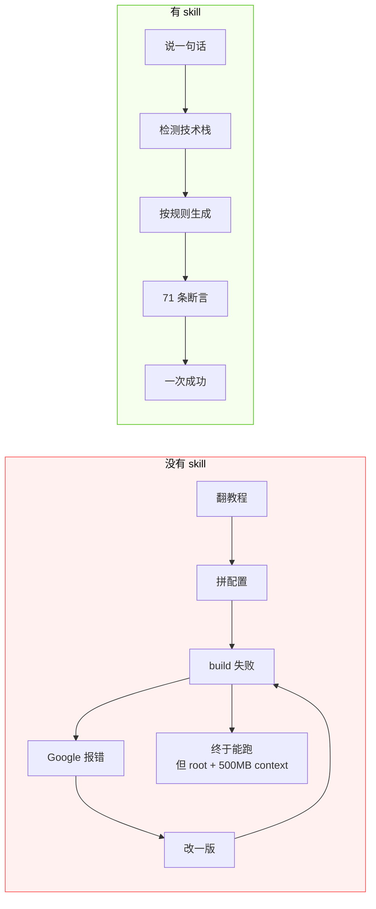
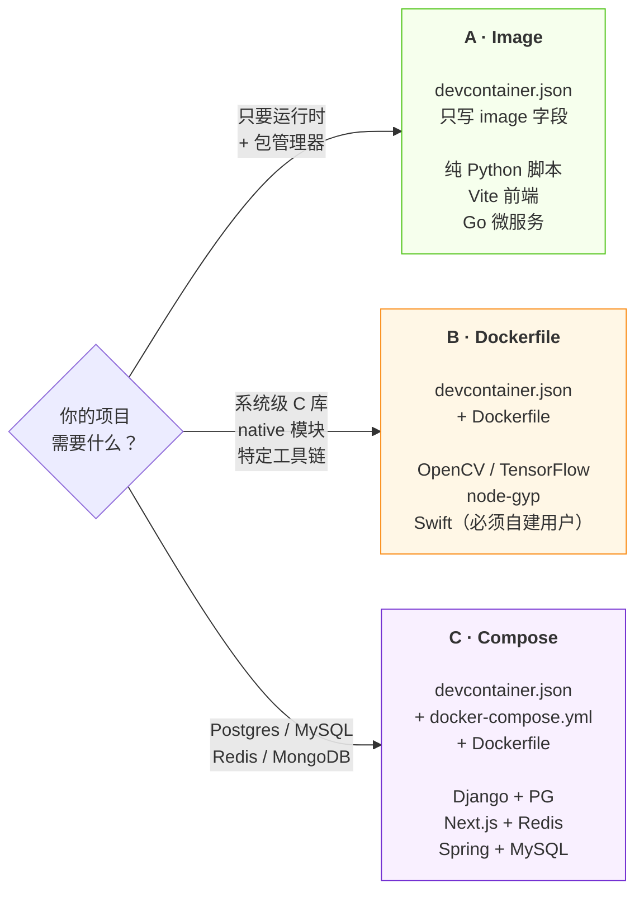

<div align="center">

# setup-devcontainer-skill

**一句话让 AI Agent 读完你的项目，生成一套真能跑起来的 devcontainer。**

<sub>不是模板复制器。检测技术栈 → 选策略 → 生成 → 71 条断言校验 → CI 真起容器。</sub>

[](https://github.com/GlariaLuminous/setup-devcontainer-skill/actions/workflows/validate.yml)
[](LICENSE)
[](templates/)
[](tests/)
[](tests/fixtures/)

[为什么](#为什么) · [它做什么](#它做什么) · [快速开始](#快速开始) · [三种策略](#三种策略怎么选) · [质量](#质量保障) · [状态](#状态)

</div>

---

## 为什么

`.devcontainer/` 这东西，**写起来不难，写对很难**。搜个教程五分钟能拼出一个 `devcontainer.json`，然后你会依次撞上这些墙：

| 你遇到的 | 真正的原因 | 通常要花 |
|---|---|:---:|
| 容器起来 3 秒就退出 | compose 少了 `command: sleep infinity` | 40 分钟 |
| `docker build` 卡在 sending context 500MB | 忘了 `.dockerignore` | 25 分钟 |
| 改完配置不生效 | 只 Reopen，没 Rebuild | 15 分钟 |
| 容器起不来：`unable to find user vscode` | 抄了 `"vscode"`，可这个镜像只有 `node` 用户 | 1 小时 |
| 进容器是 root，文件全变 root 所有 | 没设 `remoteUser` | 30 分钟 |
| Codespaces 里连不上数据库 | 用了 compose 的 `ports:` 而不是 `forwardPorts` | 1 小时 |
| 同事 clone 下来跑不起来 | 你的 tag 是 `latest`，他拉到了新版 | ∞ |

**这些不是知识问题，是记忆问题。** 每个坑单看都很蠢，合起来能吃掉一个下午。

这个 skill 把上面每一条都写成了机器可查的规则——**并且 CI 里真的起容器验证过**。

---

## 它做什么

```text
你：  > 给我的项目配一个 dev container

Agent：检测到 Python 3.12 + uv + pytest，依赖里有 psycopg2 → 需要 PostgreSQL
       策略：C（compose）
       生成：.devcontainer/devcontainer.json
             .devcontainer/Dockerfile
             .devcontainer/docker-compose.yml
             .dockerignore
       校验：46 条模板断言 + 25 条 fixture 断言 → 全过
       下一步：Ctrl+Shift+P → Dev Containers: Reopen in Container
```

生成的配置满足这些硬约束（不满足会被 Step 9 挡回去重做）：

- `remoteUser` 非 root，**且必须是该镜像真实存在的用户**
- 数据库服务带 `healthcheck`，`app` 用 `condition: service_healthy` 等它真的就绪
- `.dockerignore` 默认生成，不用你记得
- 依赖安装命令用锁定模式（`npm ci` / `uv sync --frozen` / `pnpm --frozen-lockfile`）
- 不挂宿主机 `.ssh`，不 `privileged`，不烘焙密钥



---

## 快速开始

```bash
# 1. 装到 agent skills 目录
git clone https://github.com/GlariaLuminous/setup-devcontainer-skill.git \
  ~/.agents/skills/setup-devcontainer-skill

# 2. 进你的项目，对 agent 说一句话
cd your-project && opencode
```

```text
> 给我的项目配一个 dev container
```

```bash
# 3. 打开容器
#    VS Code:    Ctrl+Shift+P → Dev Containers: Reopen in Container
#    Codespaces: 推到 GitHub，Code → Codespaces
#    CLI:        devcontainer up --workspace-folder .
```

Windows 用 PowerShell 装：`git clone ... "$HOME\.agents\skills\setup-devcontainer-skill"`

---

## 三种策略怎么选

**什么时候该写 Dockerfile，什么时候该上 compose？** 决策规则内置在 SKILL.md 的 Step 2：



> **Strategy C 一定连带生成 Dockerfile。** compose 的 `app` 服务从它 build，缺了 `docker compose build` 当场失败。这是手写 compose 最常见的坑，也是这个仓库第一条被 fixture 抓出来的 bug。

---

## 覆盖范围

| | 内容 |
|---|---|
| **语言** | Python · Node/TS · Go · Rust · Java · Kotlin · Scala · .NET · Ruby · PHP · C/C++ · Swift · Deno（13 种） |
| **数据库** | PostgreSQL · MySQL · MongoDB · Redis（带 healthcheck） |
| **包管理器** | uv · poetry · pdm · pip · npm · pnpm · yarn · bun · cargo · go · maven · gradle · dotnet · bundler · composer · sbt · swift · deno（18 种） |

> **Kotlin / Scala / Swift / Deno 是官方模板库没覆盖的四个。** 官方 [devcontainers/templates](https://github.com/devcontainers/templates) 只提供约 40 个主流组合，这四个要么自己拼 Feature，要么手写 Dockerfile 建用户——这个 skill 把它们固化成了模板。

<details>
<summary><b>展开：全部模板与镜像映射</b></summary>

| 语言 | 基础镜像 | 模板 |
|---|---|---|
| Python | `devcontainers/python` | [python.jsonc](templates/python.jsonc) |
| Node.js / TypeScript | `devcontainers/typescript-node` | [node.jsonc](templates/node.jsonc) |
| Rust | `devcontainers/rust` | [rust.jsonc](templates/rust.jsonc) |
| Go | `devcontainers/go` | [go.jsonc](templates/go.jsonc) |
| Java | `devcontainers/java` | [java.jsonc](templates/java.jsonc) |
| Kotlin | `devcontainers/java` + Gradle | [kotlin.jsonc](templates/kotlin.jsonc) |
| Scala | `devcontainers/java` + sbt Feature | [scala.jsonc](templates/scala.jsonc) |
| .NET / C# | `devcontainers/dotnet` | [dotnet.jsonc](templates/dotnet.jsonc) |
| Ruby | `devcontainers/ruby` | [ruby.jsonc](templates/ruby.jsonc) |
| PHP | `devcontainers/php` | [php.jsonc](templates/php.jsonc) |
| C / C++ | `devcontainers/cpp` | [cpp.jsonc](templates/cpp.jsonc) |
| Swift | `swift` + 自建非 root 用户 | [swift.jsonc](templates/swift.jsonc) + [Swift.Dockerfile](templates/Swift.Dockerfile) |
| Deno | `typescript-node` + Deno Feature | [deno.jsonc](templates/deno.jsonc) |

数据库模板：[docker-compose.yml](templates/docker-compose.yml)（PG + Redis）、[compose/mysql.yml](templates/compose/mysql.yml)、[compose/mongodb.yml](templates/compose/mongodb.yml)

</details>

---

## 质量保障

这个仓库**自己用自己**：`.devcontainer/` 是它给自己生成的配置，容器一起来就跑两套校验。生成的配置坏了，开发环境自己先叫。

三层，一层比一层贵：

| 层 | 命令 | 需要 Docker | 查什么 |
|---|---|:---:|---|
| **模板** | `bash tests/validate-templates.sh` | 否 | 46 条：JSONC 可解析、`remoteUser` 匹配镜像真实用户、compose `context` 必须是 `..`、Feature 路径真实存在 |
| **fixture** | `bash tests/validate-fixtures.sh` | 否 | 25 条：4 个 fixture × 6 + 1，非 root、无悬空 build 引用、不挂 `.ssh` |
| **真 build** | `bash tests/ci-run-fixture.sh tests/fixtures/<name>` | 是 | `devcontainer up` 起容器 → 在里面跑 `verify.sh` |

第二层拦的是**只有 build 才会暴露的 bug**。最典型的是 Strategy C 忘了 Dockerfile——[check-fixture-refs.mjs](tests/check-fixture-refs.mjs) 静态解析 compose 的 build 引用逐个 `stat`，不用起容器就能拦：

```text
删掉 Dockerfile          → MISSING  compose Dockerfile  .devcontainer/Dockerfile    exit 1
service 改成不存在的名字  → MISSING  service api  not defined in docker-compose.yml  exit 1
context 指向仓库外        → MISSING  compose build context  ../../../nowhere           exit 1
```

第三层是唯一能证明「生成出来真能起容器」的手段。CI 里 `build-fixtures` job 用 matrix 并发跑 4 个 fixture。

### 四个 fixture 覆盖了什么

| Fixture | 策略 | 验证的能力 |
|---|:---:|---|
| `python-pip` | A | `postCreateCommand` 装依赖、非 root 下 `pip install --user` 可写、pytest 能跑 |
| `node-npm` | A | `npm ci` 走 lockfile、真装了依赖、workspace 可写 |
| `go-mod` | A | `go mod download` / `go vet` / `go test` 容器内全绿 |
| `node-postgres` | C | healthcheck 生效、`DATABASE_URL` 注入、`workspaceFolder` 挂载、容器内 `pg_isready` 连得到 db |

---

## 状态

诚实地列出来，包括没做到的（**这是这个项目最该被 review 的部分**）：

| 能力 | 状态 | 怎么验证的 |
|---|:---:|---|
| 13 语言模板格式与用户正确 | ✅ | 46 条静态断言 |
| Strategy A 真 build | ✅ | python / node / go 三个 fixture，CI 绿 |
| Strategy C 真 build + 多服务 | ✅ | node-postgres fixture，CI 绿 |
| 数据库 healthcheck 真的等得到 | ✅ | `depends_on: service_healthy` + `pg_isready` |
| Kotlin / Scala / Swift / Deno 真 build | ⬜ | 只有静态断言，没有 fixture |
| MySQL / MongoDB compose 真起 | ⬜ | 只做了 `docker compose config` 语法校验 |
| Windows / macOS 本地路径 | ⬜ | CI 只跑 Linux，本地只在 Windows Git Bash 验过脚本语法 |
| 生成结果的端到端冒烟 | ⬜ | 没有「跑一遍 skill 再 build 产物」的测试 |

---

## 和现有方案的对比

| 方案 | 形态 | 覆盖 Kotlin/Scala/Swift/Deno | 读你的代码 | 生成后校验 |
|---|---|:---:|:---:|:---:|
| **本 skill** | Agent Skill | ✅ | ✅ 扫 14 类清单 + 4 类服务 | ✅ 71 条 |
| 官方 [devcontainers/templates](https://github.com/devcontainers/templates) | OCI 模板 | ❌ | ❌ 人肉选 | ❌ |
| VS Code「Add Dev Container Configuration Files」 | 编辑器命令 | ❌ | ⚠️ 只认文件名 | ❌ |
| Codespaces 默认镜像 | 托管 | — | ❌ | — |
| 手写 | 手工 | ✅ | ✅ 你自己 | ❌ |

官方模板赢在**可复现的 OCI 分发**（`devcontainer templates apply` 一条命令拉到任意机器），这个 skill 走另一条路：**读你的实际代码，而不是让你从 40 个模板里猜**。

两者可以共存：官方模板适合「我知道我要什么」，这个 skill 适合「我不知道该配什么」。

---

## 内置的坑位清单

**就算你不用这个 skill，这些也值得知道**：

1. **compose 容器秒退** — 缺 `command: sleep infinity`
2. **build context 爆炸** — 缺 `.dockerignore`
3. **改配置不生效** — 要 Rebuild，不是 Reopen
4. **root 污染宿主机文件** — 缺 `remoteUser`
5. **`unable to find user vscode`** — `typescript-node` 只有 `node`，`universal` 只有 `codespace`
6. **Codespaces 端口不通** — 该用 `forwardPorts` 不是 `ports:`
7. **服务没就绪就连** — 缺 `depends_on: condition: service_healthy`
8. **镜像 tag 漂移** — 用 `latest` 导致同事环境不同
9. **`.ssh` 被挂进容器** — 用 agent forwarding，别挂目录
10. **Rust 调试器断不了** — 缺 `capAdd: ["SYS_PTRACE"]` + `securityOpt: ["seccomp=unconfined"]`
11. **Strategy C 在 Docker Compose ≥ v2.39 上 build 失败** — bake 拒绝 context 外的 Dockerfile，设 `BUILDX_BAKE_ENTITLEMENTS_FS=0`（[devcontainers/cli#1320](https://github.com/devcontainers/cli/issues/1320)）
12. **Feature 版本漂移** — 不生成 `devcontainer-lock.json`
13. **密钥被烘焙进镜像** — `.env` 没进 `.dockerignore`

---

## 常见问题

**和 Dockerfile / docker-compose 什么关系？**
`devcontainer.json` 是入口描述文件——告诉编辑器用哪个镜像 / 哪份 Dockerfile / 哪份 compose 起容器，起来后挂什么扩展、跑什么命令。它自己不构建任何东西。

**一定要装 Docker 吗？**
本地用 VS Code 需要。Codespaces 不需要，容器跑在云端。

**是微软 / Docker 官方的吗？**
不是。DevContainer 是 [containers.dev](https://containers.dev) 上的开放规范，任何人都能实现。这是遵循该规范的第三方 Agent Skill。

**能用在 JetBrains 上吗？**
能，JetBrains Gateway 支持 Dev Containers，生成的配置通用。

**已经有 `.devcontainer/` 了怎么办？**
SKILL.md 的 `When NOT to Use` 写明**先问，不覆盖**。

---

<div align="center">
<sub>

[Dev Container 规范](https://containers.dev/implementors/json_reference/) · [官方模板库](https://github.com/devcontainers/templates) · [Dev Container CLI](https://github.com/devcontainers/cli) · [Feature 索引](https://containers.dev/features)

MIT · 与 DeepSeek / Microsoft / Docker 无隶属关系

</sub>
</div>
