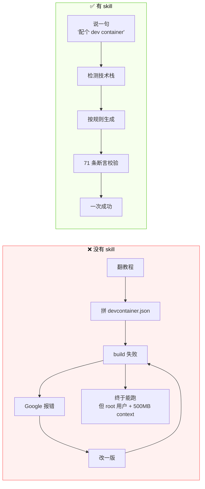
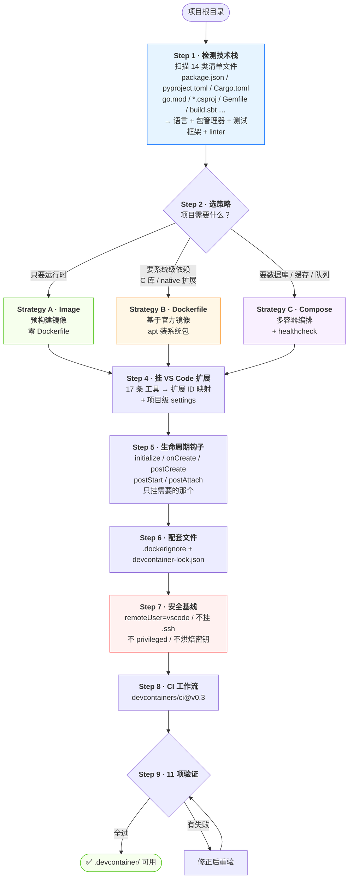
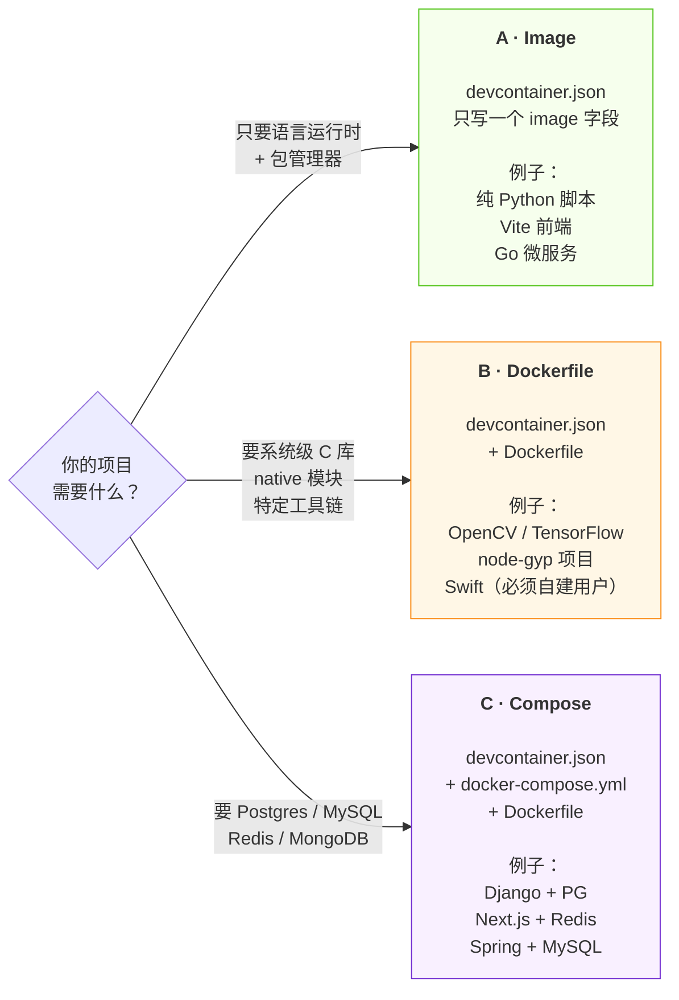

[](LICENSE)
[](CONTRIBUTING.md)
[](templates/)
[](tests/)

# setup-devcontainer-skill

> 一个给 AI Agent 用的 DevContainer 生成技能。读完你的项目，直接吐出一套能跑、能进 Codespaces、能进 CI 的 `.devcontainer/`。

<p align="center">
  <b>Detect your stack → pick a strategy → emit devcontainer.json → verify it actually builds</b>
</p>

---

## 目录

- [它到底解决什么问题](#它到底解决什么问题)
- [工作原理（架构图）](#工作原理架构图)
- [三种策略怎么选](#三种策略怎么选)
- [支持的语言与数据库](#支持的语言与数据库)
- [快速开始](#快速开始)
- [生成的文件长什么样](#生成的文件长什么样)
- [和现有方案的对比](#和现有方案的对比)
- [质量保障](#质量保障)
- [内置的坑位清单](#内置的坑位清单)
- [常见问题](#常见问题)

---

## 它到底解决什么问题

`.devcontainer/` 这个东西，**写起来不难，写对很难**。

你随便搜一个教程，五分钟能拼出一个 `devcontainer.json`。然后你会依次撞上这些墙：

| 你遇到的 | 真实原因 | 你花了多久 |
|---|---|---|
| 容器起来 3 秒就退出 | `docker-compose.yml` 里少了 `command: sleep infinity` | 40 分钟 |
| `docker build` 卡在 sending context 500MB | 忘了 `.dockerignore`，把 `node_modules` 全塞进去了 | 25 分钟 |
| 改完配置不生效 | 只 reopen 没 rebuild | 15 分钟 |
| 进容器是 root，文件全变成 root 所有 | 没设 `remoteUser` | 30 分钟 |
| 容器起不来：`unable to find user vscode` | 抄了 `remoteUser: "vscode"`，但这个镜像只有 `node` 用户 | 1 小时 |
| Codespaces 里连不上数据库 | `forwardPorts` 写错，或者用了 compose 的 `ports:` | 1 小时 |
| Swift 项目进不去容器 | 官方 `swift` 镜像压根没有 `vscode` 用户 | 2 小时 |
| 同事 clone 下来完全跑不起来 | 你的镜像 tag 是 `latest`，他拉到了新版 | 无限 |

**这些不是知识问题，是记忆问题。** 每个坑单独看都很蠢，合起来能吃掉一个下午。

这个 skill 做的事情就是：**把这些坑提前写进规则里，让 Agent 生成配置时一次绕过全部。**



---

## 工作原理（架构图）

这个 skill 不是模板复制器，是一条**带校验的生成流水线**。Agent 读 `SKILL.md` 后按九个步骤走：



**关键点：Step 9 的验证清单是硬门槛。** 11 项里任何一项不过，Agent 会被规则挡回去重做，而不是交付一个"应该能跑"的配置。

---

## 三种策略怎么选

绝大多数人卡在这里：**什么时候该写 Dockerfile，什么时候该上 compose？**



> **注意 Strategy C 会连带生成 Dockerfile。** compose 里的 `app` 服务是基于 Dockerfile 构建的，缺了它 build 直接失败——这是手写 compose 时最常踩的坑之一。

---

## 支持的语言与数据库

### 13 种语言 / 运行时

| 语言 | 基础镜像 | 模板 |
|---|---|---|
| Python | `devcontainers/python` | [python.jsonc](templates/python.jsonc) |
| Node.js / TypeScript | `devcontainers/typescript-node` | [node.jsonc](templates/node.jsonc) |
| Rust | `devcontainers/rust` | [rust.jsonc](templates/rust.jsonc) |
| Go | `devcontainers/go` | [go.jsonc](templates/go.jsonc) |
| Java | `devcontainers/java` | [java.jsonc](templates/java.jsonc) |
| Kotlin | `devcontainers/java` + Gradle | [kotlin.jsonc](templates/kotlin.jsonc) |
| Scala | `devcontainers/java` + sbt Feature | [scala.jsonc](templates/scala.jsonc) |
| .NET / C# | `devcontainers/dotnet` | [dotnet.jsonc](templates/dotnet.jsonc) |
| Ruby | `devcontainers/ruby` | [ruby.jsonc](templates/ruby.jsonc) |
| PHP | `devcontainers/php` | [php.jsonc](templates/php.jsonc) |
| C / C++ | `devcontainers/cpp` | [cpp.jsonc](templates/cpp.jsonc) |
| Swift | `swift` + 自建非 root 用户 | [swift.jsonc](templates/swift.jsonc) + [Swift.Dockerfile](templates/Swift.Dockerfile) |
| Deno | `typescript-node` + Deno Feature | [deno.jsonc](templates/deno.jsonc) |

> **Kotlin / Scala / Swift / Deno 是官方模板库没覆盖的四个。** 官方 devcontainers/templates 只提供约 40 个主流组合，这四种要么自己拼 Feature，要么手写 Dockerfile 建用户——这个 skill 把它们固化成了模板。

### 数据库 / 缓存

| 服务 | 镜像 | 模板 |
|---|---|---|
| PostgreSQL | `postgres:17-alpine` | [templates/docker-compose.yml](templates/docker-compose.yml) |
| MySQL | `mysql:8.4` | [templates/compose/mysql.yml](templates/compose/mysql.yml) |
| MongoDB | `mongo:8` | [templates/compose/mongodb.yml](templates/compose/mongodb.yml) |
| Redis | `redis:7-alpine` | [templates/docker-compose.yml](templates/docker-compose.yml) |

每个服务都带 `healthcheck` 和 `restart: unless-stopped`，`app` 用 `depends_on: condition: service_healthy` 等它真正就绪——不是等它启动，是等它 **healthy**。

### 18 种包管理器的安装命令

`postCreateCommand` 是新手最容易写错的一行。这个 skill 内置完整映射：

| 生态 | 命令 | 生态 | 命令 |
|---|---|---|---|
| uv | `uv sync --frozen` | npm | `npm ci` |
| poetry | `poetry install` | pnpm | `pnpm install --frozen-lockfile` |
| pdm | `pdm install` | yarn | `yarn install --immutable` |
| pip | `pip install -r requirements.txt` | bun | `bun install --frozen-lockfile` |
| cargo | `cargo fetch` | go | `go mod download` |
| maven | `mvn dependency:go-offline` | gradle | `./gradlew dependencies` |
| dotnet | `dotnet restore` | bundler | `bundle install` |
| composer | `composer install` | sbt | `sbt update` |
| swift | `swift package resolve` | deno | `deno install` |

优先用**锁定模式**（`--frozen` / `ci` / `--immutable`），保证容器里的依赖和 CI 里的一模一样。

---

## 快速开始

### 安装

```bash
git clone https://github.com/GlariaLuminous/setup-devcontainer-skill.git \
  ~/.agents/skills/setup-devcontainer-skill
```

Windows PowerShell：

```powershell
git clone https://github.com/GlariaLuminous/setup-devcontainer-skill.git "$HOME\.agents\skills\setup-devcontainer-skill"
```

更新：

```bash
git -C ~/.agents/skills/setup-devcontainer-skill pull --ff-only
```

安装或更新后重启 agent 客户端加载新内容。

### 使用

```bash
cd 你的项目
opencode
```

然后：

```text
> 给我的项目配一个 dev container
```

Agent 会：扫描项目 → 告诉你检测到了什么 → 问你要不要加数据库 → 生成文件 → 跑验证清单。

### 在 VS Code 里打开

生成完成后，命令面板（`Ctrl+Shift+P`）→ **Dev Containers: Reopen in Container**。

> 改过配置之后要 **Rebuild Container**，单纯 reopen 不会重新 build。这是第 3 大高频坑。

---

## 生成的文件长什么样

```text
你的项目/
├── .devcontainer/
│   ├── devcontainer.json          # 主配置，一定有
│   ├── Dockerfile                 # Strategy B / C 才有
│   ├── docker-compose.yml         # Strategy C 才有
│   └── devcontainer-lock.json     # 用了 Feature 才生成，锁版本
├── .dockerignore                  # 一定有，防止 build context 爆炸
└── .github/workflows/
    └── devcontainer.yml           # 可选，CI 里跑同一套环境
```

**`.dockerignore` 是默认生成的**，不是可选项。没有它，`node_modules` + `.git` 会让 build context 从 2MB 涨到 500MB，每次 build 都在重新传输。

---

## 和现有方案的对比

| 方案 | 形态 | 覆盖 Kotlin/Scala/Swift/Deno | 能读你的项目 | 有生成后校验 |
|---|---|:---:|:---:|:---:|
| **本 skill** | Agent Skill | ✅ | ✅ 扫描 14 类清单 + 4 类服务 | ✅ 11 项清单 |
| 官方 [devcontainers/templates](https://github.com/devcontainers/templates) | OCI 模板 | ❌ | ❌ 靠人肉选 | ❌ |
| VS Code「Add Dev Container Configuration Files」 | 编辑器命令 | ❌ | ⚠️ 只认文件名 | ❌ |
| Codespaces 默认镜像 | 托管环境 | — | ❌ | — |
| 手写 | 手工 | ✅ | ✅ 你自己 | ❌ |

**官方模板库的优势是"可复现的 OCI 分发"**——`devcontainer templates apply` 一条命令拉到任意机器。这个 skill 走的是另一条路：**让 Agent 读你的实际代码，而不是让你从 40 个模板里猜哪个合适。**

两者可以共存：官方模板适合"我知道我要什么"，这个 skill 适合"我不知道该配什么"。

---

## 质量保障

这个仓库自己用自己：`.devcontainer/devcontainer.json` 是它给自己生成的配置，容器一起来就跑 `bash tests/validate-templates.sh`——**如果生成的配置坏了，开发环境自己会先报错。**

三层校验，一层比一层贵：

| 层 | 命令 | 需要 Docker | 查什么 |
|---|---|---|---|
| 模板 | `bash tests/validate-templates.sh` | 否 | 46 条断言：13 个模板齐全且 JSONC 可解析、`remoteUser` 必须与该镜像真实用户一致、compose 的 `context` 必须是 `..`、Feature 路径必须真实存在、不得残留占位符 |
| fixture | `bash tests/validate-fixtures.sh` | 否 | 4 个真实小项目 × 6 条：非 root、无悬空 build 引用、不挂 `.ssh`、JSON 可解析 |
| 真 build | `bash tests/ci-run-fixture.sh tests/fixtures/<name>` | 是 | `devcontainer up` 真起容器，再在里面跑该 fixture 的 `verify.sh` |

第二层拦的是**只有 build 才会暴露的那类 bug**——最典型的就是 Strategy C 忘了写 Dockerfile：compose 的 `build.dockerfile` 指过去，文件不存在，`docker compose build` 当场失败。`tests/check-fixture-refs.mjs` 静态解析 compose 的 build 引用并逐个 `stat`，不用起容器就能拦下。把 `node-postgres` 的 Dockerfile 临时移走，脚本立刻输出 `MISSING  compose Dockerfile  .devcontainer/Dockerfile` 并 exit 1。

第三层是唯一能证明「生成出来的配置真的能起容器」的手段。`.github/workflows/validate.yml` 里 `build-fixtures` job 用 matrix 并发跑 4 个 fixture，每个都走一遍 `devcontainer up` → `devcontainer exec bash verify.sh`。

### 四个 fixture 覆盖了什么

| Fixture | 策略 | 验证的能力 |
|---|---|---|
| `python-pip` | A（官方镜像） | `postCreateCommand` 装依赖、非 root 用户下 `pip install --user` 可写、pytest 能跑 |
| `node-npm` | A | `npm ci` 走 lockfile、node 版本锁在 22、workspace 挂载可写 |
| `go-mod` | A | `go mod download`、`go vet`、`go test` 在容器内全绿 |
| `node-postgres` | C（compose） | 服务依赖健康检查生效、`DATABASE_URL` 注入到容器、`workspaceFolder` 挂载正确、容器内能连到 db |

CI 在每次 push / PR 时跑全部三层，外加对三个 compose 文件做 `docker compose config` 语法校验。

---

## 内置的坑位清单

这些是 skill 会主动帮你避开的问题。列出来是因为——**就算你不用这个 skill，这些也值得知道**：

1. **compose 容器秒退** — 缺 `command: sleep infinity`，进程一结束容器就没了
2. **build context 爆炸** — 缺 `.dockerignore`
3. **改配置不生效** — 要 Rebuild，不是 Reopen
4. **root 用户污染宿主机文件** — 缺 `remoteUser`
5. **Codespaces 端口不通** — 该用 `forwardPorts` 而不是 compose 的 `ports:`
6. **服务没就绪就连** — 缺 `depends_on: condition: service_healthy`
7. **镜像 tag 漂移** — 用 `latest` 导致同事环境和你不一样
8. **`.ssh` 被挂进容器** — 用 agent forwarding，别挂目录
9. **Rust 调试器断不了** — 缺 `capAdd: ["SYS_PTRACE"]` + `securityOpt: ["seccomp=unconfined"]`
10. **Swift 进不去容器** — 官方镜像没有 `vscode` 用户，必须自建
11. **Feature 版本漂移** — 不生成 `devcontainer-lock.json`
12. **密钥被烘焙进镜像** — `.env` 没进 `.dockerignore`

---

## 常见问题

**Q：和 Dockerfile / docker-compose 是什么关系？**

`devcontainer.json` 是**入口描述文件**，它告诉编辑器"用哪个镜像 / 哪份 Dockerfile / 哪份 compose 起容器，起来之后挂什么扩展、跑什么命令"。它本身不构建任何东西，构建还是交给 Docker。

**Q：一定要装 Docker 吗？**

本地用 VS Code 需要。GitHub Codespaces 不需要——它的容器跑在云端。

**Q：这个项目是微软 / Docker 官方的吗？**

不是。"DevContainer" 是 [containers.dev](https://containers.dev) 上的开放规范，任何人都可以实现。这个仓库是一个遵循该规范的第三方 Agent Skill。

**Q：能用在 JetBrains 上吗？**

能。JetBrains Gateway 支持 Dev Containers，生成的配置是通用的。

**Q：已经有 `.devcontainer/` 了怎么办？**

skill 的 `When NOT to Use` 里明确写了：**先问，不覆盖**。已有可用配置的项目不会被直接改写。

---

## 相关链接

- [Dev Container 规范](https://containers.dev/implementors/json_reference/)
- [官方模板库](https://github.com/devcontainers/templates)
- [Dev Container CLI](https://github.com/devcontainers/cli)
- [Feature 索引](https://containers.dev/features)

## License

MIT
